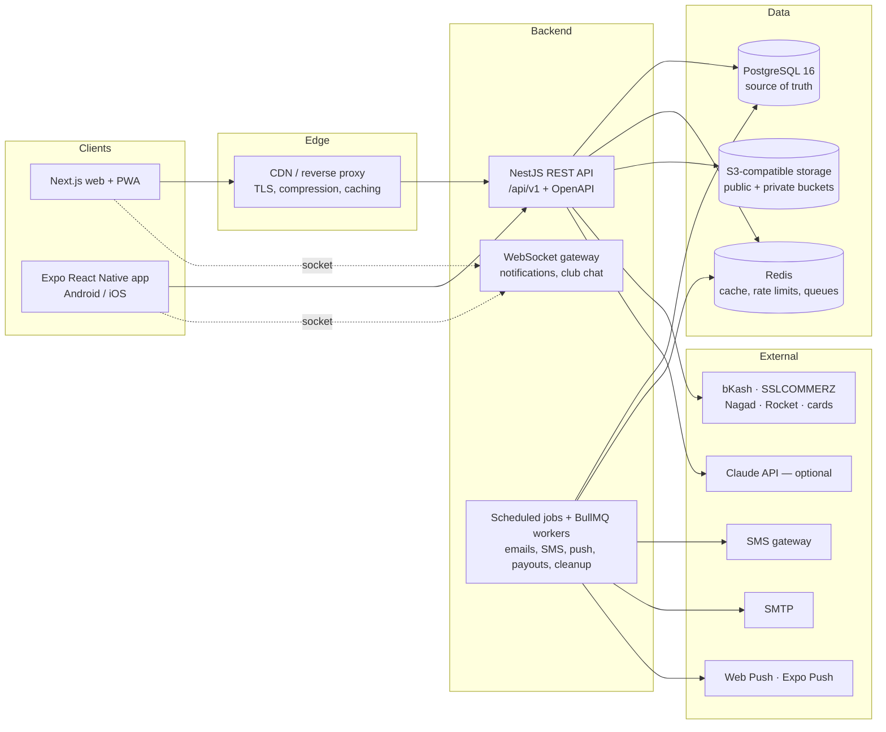

# Boikonika — system architecture

Boikonika (বইকণিকা) is a book-first multi-vendor marketplace, social reading network and learning
platform for Bangladesh. One backend API serves the website, the installable PWA and the Android/iOS
apps. Built and maintained by **Arieskonex Technologies**.

## High-level view

## Repository layout

| Path | Contents |
| --- | --- |
| `shared/` | TypeScript shared by every app: design tokens, roles and permission catalogue, status enums and transitions, Bangladesh geography, BDT money and Bangla number helpers, phone and ISBN validation, i18n messages (`bn`, `en`), API envelope types. |
| `database/` | Drizzle ORM schema (127 tables), SQL migrations, seed data, search-text and aggregate helpers. |
| `backend/` | NestJS API: modules per domain, guards, validation, OpenAPI, jobs. |
| `web/` | Next.js App Router site + PWA (Tailwind CSS v4, next-intl). |
| `mobile/` | Expo React Native app using the same API and shared package. |
| `tests/` | Cross-app end-to-end tests (Playwright) and load tests. |
| `infrastructure/` | Docker, Compose, Nginx and CI/CD configuration. |
| `docs/` | Architecture, ADRs, API, database, deployment, security and user guides. |

## Backend modules

Every domain is a NestJS module with its own controller(s), service(s) and zod schemas. Services take
a `DbOrTx` so that any operation can join a caller's transaction.

| Module | Responsibility |
| --- | --- |
| `auth` | Registration (email/mobile), password and OTP login, refresh-token rotation, 2FA (TOTP + recovery codes), Google sign-in, sessions/devices, login history, suspicious-login detection. |
| `rbac` | Roles, permission catalogue, `@RequirePermissions()` guard, per-user grants and denials. |
| `users` / `profiles` | Profiles, privacy settings, follows, blocks, interests, account deletion and data export. |
| `kyc` | Verification requests, private document upload, review workflow, encryption, audit trail, retention purge. |
| `catalog` | Books, formats/ISBN, authors, publishers, categories, genres, tags, previews, digital assets. |
| `marketplace` | Sellers, stores, products, variants, inventory ledger, seller dashboards. |
| `search` | PostgreSQL full-text + trigram search, autocomplete, filters, query analytics. |
| `cart` / `checkout` / `orders` | Carts, coupons, shipping quotes, multi-vendor orders split into seller orders, status machine, returns. |
| `payments` | Gateway abstraction (bKash, SSLCOMMERZ, COD, sandbox), webhooks/IPN, idempotency, refunds, payouts. |
| `shipping` | Shipping methods, shipments, tracking events, delivery staff updates. |
| `community` | Reviews, posts, comments, likes, bookmarks, feed. |
| `clubs`, `reading`, `student` | Book clubs, library and reading progress, challenges, badges/XP, quizzes, notes, competitions. |
| `notifications` | In-app, push, email and SMS with per-user preferences, outbox delivery. |
| `moderation` | Reports, actions (warn/remove/restrict/suspend/ban), copyright claims and counter-notices. |
| `cms` / `admin` | Homepage builder, banners, pages, articles, FAQs, settings, audit log, analytics. |
| `ai` | Optional book and writing assistants with quotas and safety rules. |

## Request lifecycle

1. `RequestIdMiddleware` assigns `X-Request-Id` (or accepts a well-formed one from the proxy) and logs one line per request.
2. Helmet security headers, CORS allowlist, 1 MB body limit, cookie parsing.
3. Global guards: rate limiting (Redis-backed), JWT authentication (routes are private unless marked `@Public()`), permission checks.
4. `ZodValidationPipe` validates bodies and queries against schemas from `shared/`; the same schemas generate the OpenAPI document.
5. The controller calls a service; services enforce ownership (a seller only sees their own seller orders) — never only the UI.
6. `EnvelopeInterceptor` wraps results as `{ success, data, message, errors, meta? }`; `AllExceptionsFilter` maps errors (including PostgreSQL constraint violations) to the same envelope with a stable `code` and the request id — never a stack trace.

## Core design decisions

- **PostgreSQL is the single source of truth.** Redis holds only derived or short-lived data (cache, rate-limit counters, queues, OTP throttles). See [ADR 0002](adr/0002-postgresql-drizzle.md).
- **Books vs offers.** A `book` is the bibliographic work, `book_formats` are concrete editions (ISBN-13 unique), and `products` are per-seller offers with condition, price and stock. One book page aggregates every seller's offer. See [ADR 0005](adr/0005-catalog-books-and-offers.md).
- **Multi-vendor orders.** `orders` (what the customer paid) → `seller_orders` (one per seller, own status, shipment, commission and payout) → `order_items` (price snapshots). See [ADR 0006](adr/0006-multi-vendor-orders.md).
- **Money** is `NUMERIC(14,2)` with an explicit currency; application code uses integer poisha. See [ADR 0004](adr/0004-money.md).
- **Inventory** is reserved with a conditional `UPDATE` inside the order transaction; CHECK constraints make overselling impossible, and `inventory_movements` is an append-only ledger.
- **Search** uses generated `tsvector` columns plus `pg_trgm` for typo tolerance, across Bangla and Latin names. See [ADR 0007](adr/0007-search.md).
- **Private files** (KYC documents, e-books) live in a private bucket and are only served through short-lived signed URLs after an authorization check.

## Security architecture (summary)

- Argon2id password hashing (OWASP parameters), account lockout and progressive rate limits.
- Short-lived access JWT (15 min) + rotating refresh token in an HTTP-only, `SameSite=Lax` cookie (web) or secure storage (mobile); refresh-token reuse revokes the whole session family.
- TOTP two-factor authentication with hashed recovery codes; suspicious-login detection (new device + new network) triggers a notification.
- RBAC with a permission catalogue (`users.view`, `kyc.approve`, `orders.refund`, …) checked on the server for every request.
- AES-256-GCM encryption for sensitive columns (document numbers, payout accounts, 2FA secrets).
- Append-only `audit_logs`, `kyc_events` and `inventory_movements` enforced by database triggers.
- Strict CSP on the web app, security headers on the API, upload validation by magic bytes, size limits and private storage.

See `security.md` for the full threat model and checklist.
