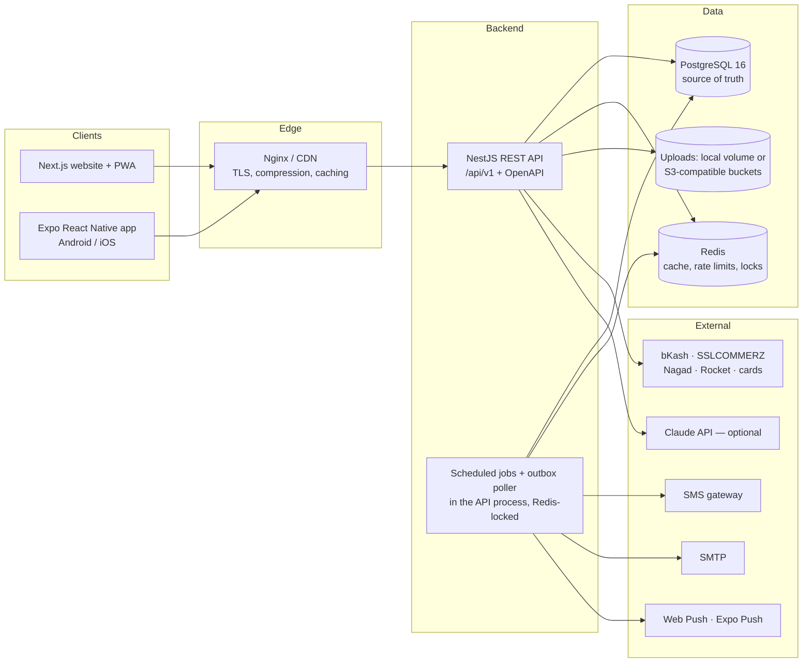

# Boikonika — system architecture

Boikonika (বইকণিকা) is a book-first multi-vendor marketplace, social reading network and learning
platform for Bangladesh. One backend API serves the website, the installable PWA and the Android/iOS
apps. Built and maintained by **Arieskonex Technologies**.

## High-level view

## Repository layout

| Path | Contents |
| --- | --- |
| `shared/` | TypeScript shared by every app: design tokens, roles and permission catalogue, status enums and transitions, Bangladesh geography, BDT money and Bangla number helpers, phone and ISBN validation, i18n messages (`bn`, `en`), API envelope types. |
| `database/` | Drizzle ORM schema (127 tables), SQL migrations, seed data, search-text and aggregate helpers. |
| `backend/` | NestJS API: modules per domain, guards, validation, OpenAPI, jobs. |
| `web/` | Next.js App Router site + PWA (Tailwind CSS v4, next-intl). |
| `mobile/` | Expo React Native app using the same API and shared package. |
| `tests/` | Browser end-to-end and accessibility tests (Playwright + axe) and a load smoke test. |
| `infrastructure/` | Dockerfiles, Docker Compose, Nginx. CI lives in `.github/workflows/` at the repository root. |
| `docs/` | Architecture, ADRs, API, database, deployment, security, testing, integrations and user guides. |

## Backend modules

Every domain is a NestJS module (`backend/src/modules/*`) with its own controller(s), service(s) and zod
schemas from `shared/`. Services take a `DbOrTx` so that any operation can join a caller's transaction.

| Module | Responsibility |
| --- | --- |
| `auth` | Registration (email/mobile + code), password and one-time-code login, refresh-token rotation with reuse detection, two-step verification (TOTP + recovery codes), Google sign-in, sessions/devices, login history, suspicious-login alerts. |
| `rbac` | Roles, permission catalogue, `@RequirePermissions()` guard, per-user grants. |
| `profiles` | Profiles, privacy settings, follows, blocks, interests, avatars, data export and account deletion. |
| `kyc` | Identity verification for sellers, authors and publishers: private documents, encrypted numbers, review workflow, retention purge. |
| `catalog` | Books, editions/ISBN, authors, publishers, categories, genres; search and autocomplete; homepage sections; recommendations; sitemap data. |
| `marketplace` | Sellers, stores, listings, variants, inventory ledger, seller dashboards. |
| `commerce` | Cart (guest + account), coupons, shipping quotes, checkout, multi-vendor orders, payments (bKash, SSLCOMMERZ, COD, sandbox), refunds, returns, payouts, shipments, wishlist. |
| `digital` | E-book files, previews, rights declarations, signed downloads, the author/publisher studio. |
| `creators` | Author and publisher dashboards and profiles. |
| `reviews` / `community` | Ratings and reviews; posts, comments, likes, bookmarks, feed. |
| `clubs` / `reading` / `gamification` / `student` | Book clubs; library and reading progress, sessions, goals; challenges, badges, XP; quizzes, notes, events, competitions, scholarships. |
| `notifications` | In-app inbox, preferences, Web Push and Expo push, email and SMS through a database outbox. |
| `moderation` | Reports, actions (warn/remove/restrict/suspend), copyright claims, account standing. |
| `cms` / `admin` / `settings` / `audit` | Homepage builder, banners, pages, articles, FAQs, contact messages; dashboards, user management, platform settings, audit log. |
| `ai` | Optional book and writing assistants (Claude) with daily limits and safety rules. |
| `health` / `dev` | Health check; development-only outbox viewer (never enabled in production). |

## Background work

There is no separate worker process. The API runs:

- **Outbox delivery** (every 5 s): emails, SMS and pushes are written to `outbound_messages` in the same
  transaction as the change that caused them, then delivered with a lease so a crash retries and two
  API instances never send the same message twice.
- **Payment expiry** (every minute): unpaid online orders past their deadline are checked with the gateway,
  then cancelled and their stock released.
- **Refund processing** (every minute): approved refunds are sent to their gateway.
- **KYC retention** (03:15 Asia/Dhaka daily): identity documents past their retention date are deleted.

The minute jobs take a Redis lock, so several API instances can run side by side.

## Request lifecycle

1. `RequestIdMiddleware` assigns `X-Request-Id` (or accepts a well-formed one from the proxy) and logs one line per request.
2. Helmet security headers, CORS allowlist, 1 MB body limit, cookie parsing.
3. Global guards: rate limiting (Redis-backed, per IP), JWT authentication (routes are private unless marked `@Public()`), permission checks.
4. `ZodValidationPipe` validates bodies and queries against schemas from `shared/`; the same schemas generate the OpenAPI document.
5. The controller calls a service; services enforce ownership (a seller only sees their own seller orders) — never only the UI.
6. `EnvelopeInterceptor` wraps results as `{ success, data, message, errors, meta? }`; `AllExceptionsFilter` maps errors (including PostgreSQL constraint violations) to the same envelope with a stable `code` and the request id — never a stack trace.

## Core design decisions

- **PostgreSQL is the single source of truth.** Redis holds only derived or short-lived data (cache, rate-limit counters, locks, code throttles). See [ADR 0002](adr/0002-postgresql-drizzle.md).
- **Books vs offers.** A `book` is the bibliographic work, `book_formats` are concrete editions (ISBN-13 unique), and `products` are per-seller offers with condition, price and stock. One book page aggregates every seller's offer. See [ADR 0005](adr/0005-catalog-books-and-offers.md).
- **Multi-vendor orders.** `orders` (what the customer paid) → `seller_orders` (one per seller, own status, shipment, commission and payout) → `order_items` (price snapshots). See [ADR 0006](adr/0006-multi-vendor-orders.md).
- **Money** is `NUMERIC(14,2)` with an explicit currency; application code uses integer poisha. See [ADR 0004](adr/0004-money.md).
- **Inventory** is reserved with a conditional `UPDATE` inside the order transaction; CHECK constraints make overselling impossible, and `inventory_movements` is an append-only ledger.
- **Search** uses generated `tsvector` columns plus `pg_trgm` for typo tolerance, across Bangla and Latin names. See [ADR 0007](adr/0007-search.md).
- **Private files** (KYC documents, e-books) live in private storage and are only served through short-lived signed URLs after an authorization check.
- **One API for every client.** The website and the mobile app call the same `/api/v1`; response types live in `shared/src/api/types.ts`. Web sessions use an HTTP-only refresh cookie, the app keeps its refresh token in the Keychain / Keystore.

## Security architecture (summary)

- Argon2id password hashing (OWASP parameters), account lockout and progressive rate limits.
- Short-lived access JWT (15 min) + rotating refresh token in an HTTP-only, `SameSite=Lax` cookie (web) or secure storage (mobile); refresh-token reuse revokes the whole session family.
- TOTP two-factor authentication with hashed recovery codes; suspicious-login detection (new device + new network) triggers a notification.
- RBAC with a permission catalogue (`users.view`, `kyc.approve`, `orders.refund`, …) checked on the server for every request.
- AES-256-GCM encryption for sensitive columns (document numbers, payout accounts, 2FA secrets).
- Append-only `audit_logs`, `kyc_events` and `inventory_movements` enforced by database triggers.
- Content Security Policy and security headers on the website and API, upload type checks from file contents (images are re-encoded), size limits and private storage.

See `security.md` for the full threat model and checklist.
