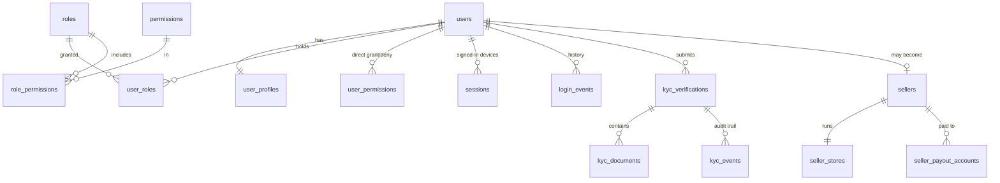
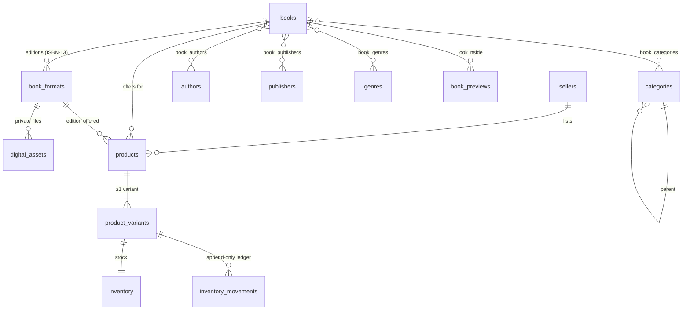
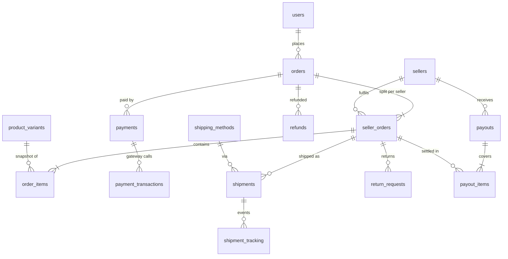
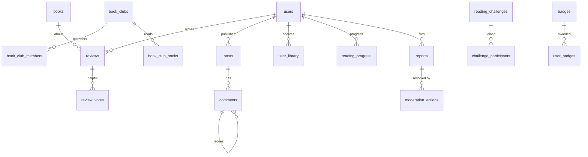

# Database

PostgreSQL 16 with the `pgcrypto`, `citext`, `pg_trgm` and `unaccent` extensions. The schema is
defined with Drizzle ORM in `database/src/schema/*.ts` (127 tables) and applied through versioned
SQL migrations in `database/migrations/`.

## Conventions

| Topic | Rule |
| --- | --- |
| Keys | `uuid` primary keys (`gen_random_uuid()`); high-volume logs (`audit_logs`, `analytics_events`, `ai_usage`) use `bigserial`. |
| Time | `timestamptz` everywhere; `created_at` / `updated_at` maintained by a trigger on every table that has `updated_at`. |
| Soft delete | `deleted_at` on users, books and products (history and orders keep pointing at them). |
| Money | `NUMERIC(14,2)` + `currency CHAR(3)` (default `BDT`). Never floats. |
| Bilingual text | `jsonb` `{ "bn": "…", "en": "…" }` for admin-managed content (categories, pages, badges). |
| Enums | PostgreSQL enums generated from the arrays in `@boikonika/shared` so API and database agree. |
| Integrity | CHECK constraints (non-negative stock and prices, rating ranges, ISBN-13 format, BD phone format), partial unique indexes (one open KYC request per purpose, ISBN unique when present). |
| Append-only | `audit_logs`, `kyc_events`, `inventory_movements` reject UPDATE/DELETE via a trigger. |
| Search | Generated `tsvector` columns + GIN; trigram GIN indexes on titles and names. |
| Secrets | Document numbers, payout account numbers and 2FA secrets are AES-256-GCM encrypted by the API; only the last 4 characters are stored in clear for display. Passwords are Argon2id hashes. |

## Domains

| File | Tables |
| --- | --- |
| `identity.ts` | users, user_profiles, roles, permissions, role_permissions, user_roles, user_permissions, sessions, login_events, otp_codes, verification_tokens, two_factor_recovery_codes, oauth_accounts, user_interests, follows, user_blocks, user_restrictions, user_activity_days |
| `kyc.ts` | kyc_verifications, kyc_documents, kyc_events |
| `catalog.ts` | categories, genres, tags, authors, publishers, publisher_authors, books, book_formats, book_authors, book_publishers, book_categories, book_genres, book_tags, book_images, book_previews, digital_assets, ownership_declarations, book_daily_stats |
| `marketplace.ts` | sellers, seller_stores, seller_payout_accounts, products, product_categories, product_variants, product_images, inventory, inventory_movements |
| `commerce.ts` | addresses, carts, cart_items, wishlists, wishlist_items, coupons, coupon_usages, recently_viewed, search_history, search_queries |
| `orders.ts` | orders, seller_orders, order_items, order_status_history, return_requests, return_items |
| `payments.ts` | payments, payment_transactions, refunds, payouts, payout_items |
| `shipping.ts` | shipping_methods, shipments, shipment_tracking |
| `community.ts` | reviews, review_votes, posts, post_media, comments, likes, bookmarks |
| `clubs.ts` | book_clubs, book_club_members, book_club_posts, book_club_events, book_club_books, book_club_schedule, book_club_polls, book_club_poll_options, book_club_poll_votes |
| `reading.ts` | badges, user_badges, reading_challenges, challenge_participants, reading_progress, reading_sessions, reading_goals, user_library, reading_lists, reading_list_items, reading_history, downloads, xp_events, user_stats |
| `student.ts` | quizzes, quiz_questions, quiz_attempts, user_notes, events, competitions, competition_entries, scholarships |
| `notifications.ts` | notifications, notification_preferences, push_subscriptions, outbound_messages |
| `moderation.ts` | reports, moderation_actions, copyright_claims |
| `cms.ts` | banners, homepage_sections, cms_pages, articles, faqs, testimonials |
| `system.ts` | analytics_events, audit_logs, system_settings, ai_usage |

## Entity relationships

### Identity, roles and verification



### Catalogue and marketplace



### Orders, payments and delivery



### Community and reading



## Working with migrations

```bash
# 1. Change the schema in database/src/schema/*.ts
# 2. Generate SQL and review it
pnpm db:generate
# 3. Apply (uses DATABASE_URL)
pnpm --filter @boikonika/database build && pnpm db:migrate
```

- Custom SQL (triggers, views) goes in a custom migration: `pnpm --filter @boikonika/database exec drizzle-kit generate --custom --name <name>`.
- Migrations are forward-only in production. To undo a change, write a new migration.
- Migrations run in a transaction and are recorded in `drizzle.__drizzle_migrations`.

## Seeding

```bash
pnpm db:seed          # roles, permissions, categories, genres, badges, challenges,
                      # shipping methods, settings, CMS pages, homepage sections, FAQs,
                      # and the first super admin from SEED_ADMIN_EMAIL / SEED_ADMIN_PASSWORD
pnpm db:seed:demo     # the above plus a fictional demo catalogue (refuses NODE_ENV=production)
```

The seed is idempotent and safe to run on every deploy: reference data is upserted, admin-edited
content (pages, homepage sections, FAQs, settings) is never overwritten, the super admin's password
is never reset, and the demo catalogue is created once in a single transaction. Demo books are
public-domain works (author died more than 60 years ago), the stores and imprint are fictional, and
the demo accounts use `example.com` addresses.

## Backup and restore

```bash
# Nightly logical backup (compressed, custom format)
pg_dump --format=custom --no-owner --file=boikonika-$(date +%F).dump "$DATABASE_URL"
# Restore into an empty database
pg_restore --no-owner --dbname="$RESTORE_DATABASE_URL" boikonika-YYYY-MM-DD.dump
```

For production, also enable continuous WAL archiving / point-in-time recovery (managed PostgreSQL
services provide it) and test a restore every month.
